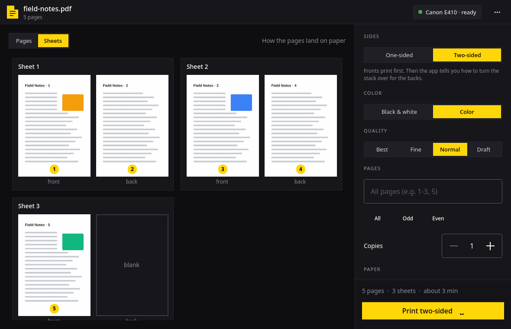

# Pritingo



Pritingo is a small desktop app for printing documents and pictures on a
Canon PIXMA E400-series inkjet from Linux: one-sided or two-sided, in color or
black and white, with every page actually coming out.

It was written for a Canon PIXMA E410 on Arch Linux / Omarchy, where two
things made printing painful:

1. **Multi-page jobs lose pages.** Through CUPS, the E410 prints only the
   first page of a job and silently drops the rest. Print a five-page PDF
   from any app and one page comes out.
2. **There is no duplexer.** Two-sided printing means printing the fronts,
   turning the stack over by hand, and printing the backs, getting the order
   and orientation right without any help from the driver.

Pritingo sends **every page as its own job**, waiting for each one to leave
the queue and for the printer to settle before sending the next, so nothing
is dropped. For two-sided printing it prints the fronts, then shows an
animated sheet turning over with the exact steps (take the blank paper out,
put back this many sheets, this one first, keep this one out because its
back stays blank), raises a desktop notification with a sound, and prints
the backs when you press Space.

It also **scans** any page from the printer's glass, to a PDF or straight to
a printed copy, with an **ID card** layout that cuts the card out of the scan and puts
its front and back on one A4 page at their real size, like a photocopy.

> 🇹🇷 **Türkçe:** Pritingo, Canon PIXMA E400 serisi yazıcılarla Linux'ta
> tek yüz ya da arkalı önlü, renkli ya da siyah-beyaz baskı yapan bir masaüstü
> uygulamasıdır. Yazıcının çok sayfalı işlerde sayfa düşürme sorununu her
> sayfayı ayrı iş olarak göndererek çözer; arkalı önlü baskıda kağıtları nasıl
> çevireceğini adım adım gösterir. Camdan PDF'e ya da doğrudan kopyaya tarar;
> kimlik kartı düzeni kartın iki yüzünü gerçek boyutunda tek A4 sayfaya
> yerleştirir. Arayüz Türkçe ve İngilizce'dir.

## Supported printers

| Printer | Status |
| --- | --- |
| Canon PIXMA **E410** | ✅ The printer it was built for (USB). The one-page-per-job method is verified on paper |
| Canon PIXMA E400, E460, E470, E480 and other models covered by the `cnijfilter-e400series` driver | ⚠️ Should work, since they share the driver, but untested. Reports welcome |
| Other Canon inkjets (other `cnijfilter` / `cnijfilter2` drivers) | ❌ Not yet. The app calls the E400-series driver directly (see below) |
| Non-Canon printers | ❌ Not yet |

Pritingo renders each page with Canon's own `pstocanonij` filter and the
`canone400.ppd` options, then sends the result raw to the CUPS queue. Support
for more printers means teaching it which filter and PPD to use, which is a
small, well-contained change in `src/backend.cpp` (`driverPpd()` and the
filter call in `sendItem()`). If you have another printer, pull requests are
very welcome. See [Contributing](#contributing).

Scanning goes through SANE (`scanimage`), not the Canon driver, so it works
with any scanner SANE knows. On the E410 the `pixma` backend found and scanned
over USB in testing. Webcams that SANE lists are skipped.

Connection: tested over **USB**. A network-connected E400-series printer
should work as long as it has a CUPS queue, but this is untested.

## Features

- **Opens almost anything**: PDF, Word, Excel, PowerPoint and LibreOffice
  documents (converted with LibreOffice), and pictures (JPEG, PNG, WebP, TIFF…). Drop a file on the window, press `O`, or run `pritingo file.pdf`.
- **Page view**: every page as a thumbnail. Click one to leave it out,
  double-click to look closer. Thumbnails turn grey when you print in black
  and white, so you see what you will get.
- **Sheet view**: which page lands on the front and back of each sheet, and
  which backs stay blank.
- **One-sided or two-sided** (guided manual duplex, see above).
- **Color or black & white**, and four quality levels from draft to best.
- **Page ranges** (`1-3, 5`, `4-`, odd / even), **copies** (each copy starts
  on a fresh sheet so copies can be handed out separately).
- **Paper**: A4, A5, B5, Letter, Legal, 10×15 and 13×18 photo, DL and #10
  envelopes; plain, glossy and Plus Glossy II photo paper.
- **Landscape pages turn** to fit portrait paper automatically.
- **More settings**: tone (light/normal/dark), intensity, contrast,
  cyan / magenta / yellow balance, which cartridges to use (black and color,
  black only, color only).
- **Second-pass controls**: print the backs in reverse order, or upside down,
  for however your printer stacks and feeds paper. A **two-sided test sheet**
  with arrows helps you find the right combination once.
- **Scanning** (`S`): any page, as A4, A5, Letter or the whole glass, or
  **Automatic**, which cuts out whatever lies on the glass (a photo, a
  receipt) and keeps it at its real size on an A4 page. Black and white or
  color, 150, 300 or 600 dpi. Each scan shows as a page you can turn or
  remove. **Save as PDF** asks where
  through the desktop's own dialog; **Print a copy** opens the scans like any
  document, so copies, two-sided and every print setting still apply.
- **ID card copies**: lay the card anywhere on the glass, scan the front, turn
  it over when the app says so, scan the back. The card is found and cut out
  of each scan, and both sides land on one A4 page at their real size.
- **Printer maintenance**: nozzle check, head cleaning, head alignment
  (Canon's own command files, sent through CUPS).
- **Knows when the printer is stuck**: if a page sits in the queue for a long
  time (usually no paper, or an error light waiting for the Resume button), it
  says so in the window and in a notification.
- **Printer status** in the top bar: connected, printing, or jobs waiting.
- **Keyboard first**, with every action on a key (`?` shows them all).
- Follows the **Omarchy theme** (accent color and window rounding) and the
  **Omarchy language** live; English and Turkish are included, and the ⋯ menu
  can pin the app's own language.

## Install

### Arch Linux (AUR)

```sh
yay -S pritingo
```

This also pulls in Canon's driver, `cnijfilter-e400series`, from the AUR.
For scanning, install SANE too: `sudo pacman -S sane`.

### Set up the printer once

Pritingo prints through CUPS, so the printer needs a queue. For an E410 on USB:

```sh
sudo systemctl enable --now cups
lpinfo -v | grep -i canon        # find the usb://Canon/E410... URI
sudo lpadmin -p Canon_E410 -E -m lsb/usr/canone400.ppd \
  -v 'usb://Canon/E410%20series?serial=XXXXXX&interface=1'
```

Use the plain `usb://` URI. In testing, Canon's own `cnijusb:` backend marked
jobs as done without printing anything. Pritingo picks `Canon_E410` if
it exists, otherwise the first queue; with several queues you can choose one
under *More settings*.

### From source

Needs Qt 6 (base, declarative, wayland), qmake6, make, a C++17 compiler,
`poppler` (pdfinfo, pdftoppm, pdftops), `qpdf`, ImageMagick and `libnotify`, plus
`sane` for scanning.

```sh
bin/build      # build/pritingo
bin/test       # unit tests, offscreen
bin/install    # builds a package from this checkout and installs it (makepkg -fsi)
```

## Using it

1. Open a file (drop it on the window, or press `O`).
2. Pick one-sided or two-sided, color or black & white, and anything else.
3. Press Space (or **Print**).
4. Two-sided: when the fronts are done, follow the steps on screen and press
   Space again for the backs.

**Getting two-sided right the first time:** take every blank sheet out of the
tray before the second pass. If any stays in, the printer feeds it instead of
your printed sheets. If the backs come out upside down or on the wrong
sheets, print the two-sided test sheet from the ⋯ menu and adjust *More
settings → Second pass*.

## Keyboard

| Key | Action |
| --- | --- |
| `O` | Open a file |
| `Space` | Print, or continue with the backs |
| `D` | One-sided / two-sided |
| `C` | Black & white / color |
| `V` | Pages / sheets view |
| `A` | Select every page |
| `+` `-` | More / fewer copies |
| `W` | Close the file |
| `S` | Scan from the glass (Space scans, `Ctrl+S` saves the PDF, `Ctrl+P` prints a copy, `C` black & white / color) |
| `Esc` | Stop printing, close a panel |
| `?` | Show the shortcuts |
| `Q` | Quit (asks while printing) |

## How it works

For each page, Pritingo:

1. extracts the page with `qpdf` (turning it 90° if it is landscape, and 180°
   for a back when *Turn backs upside down* is on),
2. converts it to PostScript at the chosen paper size with `pdftops`,
3. renders it with Canon's `pstocanonij` filter and the chosen options
   (`CNGrayscale`, `CNQuality`, `MediaType`, `PageSize`, `CNGamma`, …),
4. sends the result with `lp -o raw`,
5. waits for the job to leave the queue and the printer to settle, then moves
   on.

The original file is never modified; everything happens on a copy in a
private temporary directory.

A scan runs `scanimage` on the chosen paper size from the glass's corner, or
the whole glass for an ID card and for Automatic. To find the card or photo, Pritingo looks at the scan at about 75 dpi,
thresholds it a little below the lid's own brightness, closes the gaps the
card's light areas leave, and takes the largest connected shape
(ImageMagick's `-connected-components`), then trims the lid's color off the
edges. The PDF is written with ImageMagick next to the chosen file and renamed
into place.

## Known limitations

- Only the Canon E400-series driver is wired in (see *Supported printers*).
- A page takes about 30 seconds including the pause between jobs, so long
  documents take a while. The pause is what makes every page come out.
- The driver cannot report paper-out or ink levels; Pritingo can only notice
  that a page is taking unusually long.
- The order and orientation for the second pass depend on how you put the
  sheets back. The defaults are a starting point; print the test sheet once
  to find the right settings for your printer.
- The maintenance commands use Canon's command files and have not been
  checked on every model.
- Card and Automatic detection need the lid closed over a light background.
  A very light card, or white paper, on the white lid may not be found; Pritingo then keeps the whole glass and
  says so.

## Contributing

Issues and pull requests are open and welcome, especially:

- **support for more printers** (other Canon `cnijfilter`/`cnijfilter2`
  models, or a generic CUPS path for printers that handle multi-page jobs
  fine),
- **reports from other E400-series models** (E400, E460, E470, E480…),
- **translations**: add `src/i18n/<code>.json` (English text → translation)
  and list it in `src/resources.qrc`,
- bug reports with the steps to reproduce and, if printing failed, the output
  of `lpstat -t` and `journalctl -u cups --since -10min`.

Fork, branch, run `bin/test`, and open a pull request against `main`. Keep
the code in the style around it: C++ for the logic in `src/backend.cpp` and
`src/planner.cpp`, QML for layout only.

## License

MIT, see [LICENSE](LICENSE). The theme and translator code is adapted from
Omacut and Monologue by David Heinemeier Hansson (MIT).
